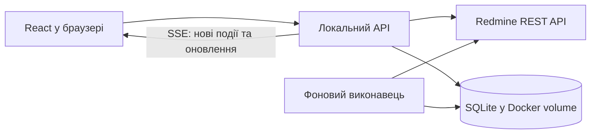

# Технічні рішення реалізації

Початкові рішення: 2026-10-02; поточний стан: 2026-10-05. Локальна реалізація працює з demo та перевіреним Redmine read-only; SQLite, Drizzle ORM / Kit та `.env` погоджені. Стек: React + TypeScript + Vite, TanStack Query, dnd-kit, i18next; Fastify, better-sqlite3, Drizzle; Vitest та Playwright. Продуктові вимоги: [RESEARCH.md](RESEARCH.md), початкове рев’ю: [REVIEW.md](REVIEW.md), результати реалізації й перевірок — у доповненнях нижче. 2026-10-05 користувач дозволив runtime запис Redmine через явний backend opt-in; усі мутаційні тести залишаються тільки demo/mocks (див. останнє доповнення Write mode).

## 1. Базова архітектура

Пропозиція: React + TypeScript у браузері; Node.js + TypeScript + Fastify як локальний сервер; фоновий виконавець у тому самому серверному процесі; SQLite у постійному Docker volume. Один контейнер застосунку, один екземпляр сервера, запуск через Docker Compose. Зібраний frontend сервер віддає з того самого origin, що й API. Порт публікується на 127.0.0.1.



API та виконавець — модулі одного застосунку. Це дозволяє працювати із закритою вкладкою, не потребує окремого сервісу черги. SQLite транзакції короткі; мережеві запити до Redmine виконуються поза транзакціями. Довгі CPU-операції не блокують серверний цикл.

## 2. Пропонований стек

| Частина | Пропозиція | Навіщо |
| --- | --- | --- |
| Інтерфейс | React + TypeScript, Vite | Дошка, модальні картки, швидке редагування; спільні типи із сервером |
| Дані в браузері | TanStack Query | Кеш запитів, фонове оновлення, контроль стану збереження |
| Drag and drop | dnd kit | Переміщення карток мишею та клавіатурою; бібліотека не визначає правила Redmine |
| Сервер | Node.js актуальної підтримуваної LTS + Fastify | Доступ до Redmine, команди, синхронізація, локальне API |
| Локальна БД | SQLite + Drizzle, міграції | Налаштування, inbox, ролі, стійкі операції та кеш |
| Мови | i18next + react-i18next | uk / pl / es / en, повідомлення й форми множини |

Версії зафіксувати при створенні проєкту, перевіривши сумісність; без автоматичного вибору prerelease / RC. Поточна Drizzle-документація містить RC-приклади — це не рекомендація встановлювати RC. Драйвер SQLite обрати після перевірки стабільних версій Node.js / ORM і Docker-збірки.

Конкретну бібліотеку UI-компонентів вибрати після першого макета; компоненти мають підтримувати focus, клавіатуру, popover і dialog. Формат редактора залежить від фактичного форматування Redmine (Markdown / Textile). Не конвертувати наявні описи без втрат; на першому етапі зберігати оригінальну розмітку, забезпечити preview із санітизацією.

Офіційні джерела перевірено 2026-10-02: [Vite](https://vite.dev/guide/), [Fastify](https://fastify.dev/docs/latest/), [TanStack Query](https://github.com/TanStack/query), [dnd kit](https://dndkit.com/), [Drizzle SQLite](https://orm.drizzle.team/docs/sqlite/get-started-sqlite), [react-i18next](https://react.i18next.com/).

### 2.1. ORM / query builder і міграції

**Погоджено 2026-10-02 відповіддю «ок, lgtm»: Drizzle ORM + Drizzle Kit**, зі схемою в TypeScript і збереженими SQL-міграціями. Наступною відповіддю погоджено SQLite; драйвер вибрати під час реалізації за сумісністю.

Drizzle дозволяє описувати схему в TypeScript, використовувати типізовані SQL-подібні запити й relational API; підтримує SQLite та PostgreSQL ([огляд](https://orm.drizzle.team/docs/overview)). Для нашого застосунку це поєднує визначення таблиць, запити до inbox / операцій / налаштувань і контроль змін схеми. ORM працює лише з локальною БД; інтеграція з Redmine залишається HTTP-адаптером.

Пропонований процес: TypeScript schema → `drizzle-kit generate` → перегляд SQL-міграції → commit міграції → застосування невиконаних міграцій перед запуском сервера / виконавця, після backup наявної БД. Не використовувати `push` як штатний механізм оновлення користувацької БД. Drizzle Kit документує обидва підходи; збережені SQL-файли обираємо для контрольованих оновлень і перевірки restore ([міграції](https://orm.drizzle.team/docs/migrations)).

Залежності й драйвер фіксувати після перевірки сумісності. Вибрати один діалект для першої версії: підтримка двох БД у бібліотеці не означає, що таблиці / типи / SQL-міграції проєкту автоматично переносимі між ними. Окремий універсальний DAL для одночасної підтримки SQLite / PostgreSQL не пропонується.

## 3. SQLite чи PostgreSQL

**Погоджено 2026-10-02: SQLite у постійному Docker volume.** Користувач зазначив, що обидві БД зберігатимуть дані в volume. Це правильно щодо стійкого збереження; підстава вибору SQLite — простіший запуск без окремого сервера БД. Паралельні записи й backup / restore також залежать від обраної БД.

SQLite — локальна БД у контейнері, без окремого database server. Файл і службові файли живуть у Docker named volume, зберігаються при оновленні контейнера. Режим WAL, foreign keys, busy timeout; один координатор записів. SQLite добре відповідає локальному збереженню стану застосунку ([рекомендовані сценарії](https://www.sqlite.org/whentouse.html)).

WAL дозволяє паралельне читання й запис, але не кілька одночасних writer-транзакцій; БД не розміщувати на мережевій файловій системі ([WAL](https://www.sqlite.org/wal.html)). Backup — через штатний механізм узгодженого snapshot або зупинку застосунку, не копіювання лише основного файла під час запису. Перед міграцією backup; окремо перевірити restore.

PostgreSQL у другому контейнері доречний, якщо користувач хоче окремий сервер БД або надалі кількох користувачів / виконавців. Перехід між діалектами потребуватиме міграцій і перевірок, він не обіцяється як автоматичний. Redis і зовнішня черга для поточного масштабу не потрібні.

## 4. Межа між Redmine та локальними даними

Налаштування зовнішнього вигляду: theme=light|dark|system, palette=blue|violet|green|amber. Це локальні налаштування SQLite, доступні в обох режимах. Системна тема реагує на prefers-color-scheme; CSS custom properties змінюють surface / text / border та акцент, без інверсії зображень. Палітра не змінює семантичні кольори помилок і CI. Перевірити всі палітри у світлій / темній темі й збереження після reload.

Redmine — джерело актуальних задач, статусів, виконавців, описів, коментарів, labels, Branch і Versions. Локальна БД — налаштування проєктів / QA, подання, shortcuts, мова, підтверджені локальні ролі, чернетки, події / unread / архів, позиції синхронізації та виконання операцій. Дозволений кеш Redmine з часом останнього оновлення.

Приблизні сутності: project_settings, saved_views, shortcuts, issue_roles, drafts, cached_issues, cached_versions, source_events, notifications, sync_cursors, automation_rules, operations, operation_steps. Усі зовнішні ID мають контекст інстансу Redmine; очищення кешу не видаляє inbox або налаштування.

## 5. Єдиний шлях виконання дій

Drag and drop, shortcut, меню й автоматизація викликають спільні серверні команди: moveIssue, updateIssue, handoffToQA, returnToDeveloper, createIssueWithBranch, finishRelease. UI не дублює правила workflow.

Перед записом — актуальна задача, перевірка передумов і доступного переходу. Зміни від інших користувачів після цієї перевірки все одно можливі: стандартний REST не дає атомарного compare-and-set для всього сценарію. Після кроку перечитати результат, при конфлікті зупинитися й показати фактичний стан.

Операція та її кроки спочатку зберігаються в БД. Повтори локального запиту використовують operation ID; записи по одній задачі серіалізовані. Review → QA виконується як assign self → QA → обраний QA; finishRelease — перевірка готовності → закриття задач → перевірка складу → закриття Version. Прогрес переживає restart. Частково виконана команда показує реальні зміни, не вдає повний успіх.

Після timeout не повторювати POST створення задачі / коментаря наосліп. Спочатку перевіряти результат; якщо його неможливо однозначно встановити, позначати як невідомий і вимагати розв'язання. Локальний operation ID сам по собі не робить Redmine API ідемпотентним.

UI може одразу показувати просте редагування як pending. Для багатокрокової передачі / завершення — видимий прогрес і фінальний фактичний стан. Чернетки не губляться при помилці. Drag and drop змінює статус / роадмапу за погодженими правилами, не створює ручний порядок карток: усередині колонки діє вибране сортування, default Priority desc.

## 6. Синхронізація й доставка в UI

Фоновий polling Redmine незалежно від браузера. Початкова пропозиція інтервалу — близько 30 секунд, із налаштуванням; це не обіцянка оновлення за 30 секунд для всіх проєктів. Частоту й кількість паралельних запитів визначити за обсягом даних і лімітами інсталяції, застосувати backoff. Навіть без підписки перевіряти погоджені активні автоматизації та задачі користувача.

Перший запуск створює baseline, не засипає inbox старою історією. Подальші цикли читають усі сторінки змінених задач і потрібні journals із часовим перекриттям; cursor пересувається лише після стійкого збереження результатів. Journal IDs забезпечують дедуплікацію. Повторна звірка потрібна для членства / watchers / Versions / змін прав. Видалені чи недоступні задачі не залишаються у кеші як чинні.

Важлива межа: polling snapshot не гарантує, що побачимо кожен проміжний перехід labels. Для CI In Progress → Failed потрібна доступна історія old / new; якщо поле не журналюється, потрібна інша інтеграція або чесно обмежене правило. Не видавати зміну snapshot за повну історію подій.

Сервер надсилає браузеру сигнали оновлення через SSE; звичайні команди йдуть HTTP. SSE — доставка від нашого сервера, не канал подій від Redmine ([опис SSE](https://developer.mozilla.org/en-US/docs/Web/API/Server-sent_events/Using_server-sent_events)). Inbox спочатку зберігається в БД; після reconnect UI перечитує його та лічильники. Кілька вкладок не запускають кілька polling-циклів. Favicon відображає стійкий unread count.

## 7. Токен і підключення

Погоджено 2026-10-02: користувач додасть токен у `.env` у корені проєкту. Пропонований контракт конфігурації:

```dotenv
REDMINE_URL=https://redmine.example.invalid
REDMINE_API_TOKEN=
```

При реалізації додати `.env` до `.gitignore` і `.dockerignore`; у репозиторії зберігати лише `.env.example` з порожнім токеном. Docker Compose явно передає ці змінні серверному контейнеру: сам факт існування `.env` не означає їх автоматичної наявності всередині контейнера. При зміні токена перестворити контейнер застосунку з новою конфігурацією, не видаляючи volume.

Ключ читає лише backend; браузер бачить стан підключення, а не ключ. Не використовувати префікс `VITE_` для токена, не передавати його в frontend build arguments і не включати `.env` у Docker image. Токен не зберігається в локальній БД або browser storage. Екран введення токена та шифроване сховище в поточний план не включати.

Логи не містять ключа; секретні поля відповіді current user відкидаються. API запису перевіряє origin / локальну сесію. Контейнер має використовувати справжній TLS, без вимикання перевірки сертифікатів; доступ через корпоративну VPN перевірити окремо.

Після додавання токена виконати read-only capability-перевірку: поточний користувач, проєкти, IDs та is_closed статусів, writable поля Branch / Labels, формат описів, Versions, journals, watchers і workflow. Записи не робити просто для перевірки підключення. Без токена — ізольований деморежим із тим самим контрактом адаптера, чітким позначенням demo.

## 8. Перевірки реалізації й порядок

Спочатку створити базовий Docker-запуск, міграції й адаптер demo / Redmine; побудувати дошку, картку, inline editing, фільтри та i18n. Далі реалізувати стійкі команди, фонову синхронізацію, inbox, релізи, погоджені автоматизації та налаштування. Це порядок роботи, не скорочення погодженого обсягу.

Перевірки фокусуються на реальних ризиках: групування roadmap / status; відновлення після часткового запису й restart; timeout після успішного запису; конфлікт іншого користувача; pagination / дедуплікація / cursor; CI old / new; unread; branch після створення; backup / restore. Інтерфейсні сценарії — перетягування, inline editing, keyboard focus / shortcuts, чотири мови. Приватну інтеграцію можна підтвердити лише після перевірки інсталяції.

## 9. Стан рішень

Локальна БД, ORM і міграції погоджені: SQLite + Drizzle ORM + Drizzle Kit. Вибір простої структури користувач доручив агенту; конкретний план наведено в розділі 10.

Погоджено: локальний Docker, один користувач, фонова робота, продуктова поведінка з RESEARCH.md. 2026-10-02 користувач погодив автоматичне закриття задач при завершенні релізу без колонки Done чи ручного кроку та надання токена через `.env` у проєкті.

Реалізаційні рішення в межах дорученої розробки: React + Vite + TypeScript, Fastify, один контейнер з API, UI і фоновим polling, SSE для оновлень відкритої вкладки. Правило вже Done погоджене: пропускати, перевіряти Deploy для решти.

## 10. Проста структура проєкту

Користувач доручив вибір структури агенту й не планує вручну підтримувати проєкт. Прийняте реалізаційне рішення: один проєкт, один package.json, зрозумілі каталоги за відповідальністю. Нижче схема відповідальностей; HTTP endpoints зібрані в server/app.ts, переклади — у client/app/i18n.ts. Окремі routes / locales каталоги поки не потрібні.

```text
src/
  client/
    app/               # запуск UI, навігація, провайдери
    features/          # board, issues, releases, notifications, settings
    components/        # спільні UI-компоненти
    lib/               # локальний API client, shortcuts
  server/
    index.ts           # запуск API та фонового виконавця
    config.ts          # серверна конфігурація, .env
    app.ts             # HTTP endpoints і SSE
    redmine/           # REST client, mapping, capabilities, demo adapter
    commands/          # редагування, передачі, Branch, завершення релізу
    sync/              # polling, journals, cursors, автоматизації
    db/                # підключення, schema, запити
  shared/              # DTO, validation schemas, типи команд і подій
drizzle/               # SQL-міграції та їх метадані
Dockerfile
compose.yaml
.env.example
package.json
```

Тести розміщувати поруч із відповідним модулем; браузерні сценарії — в e2e/. Конфігурації збірки й перевірок — у корені. Наявні RESEARCH.md, REVIEW.md і TECHNICAL.md лишаються в корені.

Правила для реалізації: client не імпортує server; shared не містить токена, доступу до БД або серверної конфігурації. routes перевіряють запит і викликають команди; бізнес-правила не розмазуються між UI, shortcut і polling. server/db містить конкретні запити, нові шари й абстракції додавати лише під реальну потребу. Один модуль не повинен перетворюватися на весь backend або всю дошку.

## 11. Питання перед початком реалізації

Останнє продуктове уточнення погоджено 2026-10-02: реліз містить дві задачі в Deploy та одну, яку вже завершили в Done через Redmine. Пропозиція — дозволити завершення, уже успішно завершену задачу пропустити, а Deploy перевіряти для решти. Rejected або довільний статус із `is_closed` не прирівнювати автоматично до успішного завершення. Користувач погодив це правило 2026-10-02; питання закрито.

Реалізацію дозволено почати. Решта невизначеностей — вибір реалізаційних деталей або перевірки інсталяції після додавання токена: поля / статуси / права, формат описів, історія CI, джерела ролей і доступ контейнера до Redmine. Повторного продуктового опитування про них не потрібно.

## 12. Режим розробки та обмеження інтеграції

Уточнення користувача: блокування мутацій **тимчасове**, лише на період розробки й тестування. Після перевірок і явного дозволу має бути можливість керовано ввімкнути запис; read-only лишається безпечним default. Поточний запуск не отримав дозволу на жодні зовнішні зміни. API-команди й UI capabilities зберігають межу, через яку потім буде підключено дозволений write adapter; теперішній transport не послаблювати.

Користувач дозволив реалізацію, Git і development subagents gpt-6-luna з max reasoning. Усі зовнішні мутації заборонені під час розробки навіть із токеном. AGENTS.md — обов’язкове джерело цієї заборони. Сервер реалізує immutable read-only real adapter і transport, GET / HEAD only, без перемикача обходу. Demo adapter дозволяє всі UX-сценарії в ізольованій локальній БД. У real mode UI показує read-only та явно блокує write actions; автоматизації лише фіксують заплановані заблоковані дії.

## 13. Реалізація та результати перевірок — 2026-10-02

Реалізовані дошка, редагування картки, релізи, inbox, фонові правила, shortcuts, чотири мови та світла / темна / системна тема з чотирма палітрами. Команди demo проходять ті самі бізнес-правила незалежно від drag and drop, форми або shortcut. Повторні команди мають ідентифікатор операції та збережений результат; локальні налаштування, історія, ролі, кеш і непрочитані події зберігаються в SQLite.

Підтверджено: 58 модульних і серверних тестів, 9 браузерних сценаріїв Chrome, TypeScript і production build. Перевірені Docker build, запуск, healthcheck, перезапуск зі збереженням SQLite. npm audit: 0 відомих вразливостей. Контрольний секрет відсутній у client bundle; `.env` виключений із Git і Docker context. Всі інтеграційні тести використовували mocks або demo без токена; реальних запитів до Redmine для цих перевірок не виконували.

Приватні поля, доступність journals / watchers, фактичні workflow і форматування ще потрібно перевірити в режимі читання. Реальний write adapter буде окремим наступним етапом після зняття тимчасової заборони. Upload вкладень та форматований renderer описів поки не реалізовані; деталі поточних меж наведено в README.md.

## 14. UX-переробка після аудиту — 2026-10-02

Вимоги наведені в RESEARCH.md §19. Переробка реалізована та перевірена в demo. Фільтри відкриваються в portal overlay без зміщення дошки; стандартні й збережені набори фільтрів показуються кнопками на дошці. Native selects замінюються спільними accessible picker із пошуком, множинним вибором, аватарами й ролями залежно від контексту. Не створювати різні несумісні picker для створення картки, редагування й фільтрів.

Ролі QA / support / developer отримувати з membership проєкту Redmine; потрібні типізоване зіставлення назв / IDs і локальні overrides з тим самим scope, що налаштування. Overrides не змінюють зовнішні memberships. Статистика рекомендацій людей — SQLite, контекст поточного користувача / інстансу / проєкту / поля; рахувати успішний ручний вибір один раз. Тимчасовий assign-self та автоматизації не спотворюють персональні рекомендації. Фото, якщо API їх не повертає, не вигадувати: UI використовує initials fallback.

Автозбереження існуючої картки — окремі field patch-команди з видимим pending / error та серіалізацією на задачу. Draft опису / коментаря відділити від серверного стану дискретних полів. Не посилати всі поля IssueDialog разом зі старим statusId / assignee / version. Оновлення кешу, повторне відкриття й DnD повинні звіряти базовий серверний стан і локальну чернетку; збереження тексту не має повертати старий статус. Створення лишається явною командою, вибір властивостей до отримання ID зберігається в чернетці.

Перевірити в demo: overlay не зміщує board; швидкі / збережені фільтри зрозуміло активуються; picker працює мишею та клавіатурою на desktop; рольова рамка / override не змінюють Redmine; рекомендації не дублюються після retry; дискретні поля зберігаються без загального Save; чернетки тексту переживають закриття / reload / помилку й не відправляються після зміни статусу. Обмеження real transport GET / HEAD залишаються чинними. Користувач відклав мобільний UX; окрема mobile-переробка та повний mobile-аудит зараз не потрібні.

Ті самі picker застосовуються в Settings: QA, цільовий статус / label / дія shortcut, мова та сортування. Для theme використовувати короткий segmented control, для palette — доступні кольорові swatches з текстовими назвами. Поточні selection і напрямок сортування видимі в закритому стані. Користувач погодив негайне збереження теми, мови та інших налаштувань, крім shortcuts: вони мають окрему чернетку й явне збереження з валідацією. Field patch налаштувань не повинен випадково включити shortcut draft; узгоджувати актуальний збережений стан між послідовними автозбереженнями.

Поточні кольори палітр і дрібні шрифти потрібно переробити; вибірковий контраст та font sizes записані в UX_BROWSER_REVIEW.md, вимоги — RESEARCH.md §19.5. Користувач відхилив масштаб 16 px / 14–16 px / 13–14 px як завеликий: зберігати компактність, прибравши насамперед проблемні 8–9 px. Не вважати locale / data-palette test перевіркою візуальної читабельності. Shortcuts: Q стає toggle зі збереженням решти фільтрів; S лишається moveStatus, Cmd/Ctrl+S зберігає активну форму. Plain letter shortcuts не перехоплюють текст / IME. Scope верхнього modal / конкретного редактора має переважати попередньо відкриту картку.


### Реалізація та перевірка

Спільний `components/pickers.tsx` містить portal popover, single/multi picker та people picker. Вкладені меню мають окремий стек фокусу й Escape; пошук підтримує ArrowUp/ArrowDown та Enter. Створення задачі має компактні chips властивостей. На дошці видно короткі кнопки фільтрів і повний критерій / напрямок сортування. Різні значення одного поля фільтра поєднуються через OR; різні поля — через AND.

Додаткове уточнення користувача реалізовано через `components/choiceTiles.tsx`: priority/type — компактні кольорові плитки з radiogroup/radio, позначенням вибору та навігацією стрілками. Assignee — до п’яти рекомендованих аватарів і круглий Plus, що відкриває повний searchable people picker. Обидві форми використовують однакові контролі. На наявній задачі вибір зберігається одразу, на створенні — лише після submit.

Проєктні trackers читаються через `include=trackers` на наявному GET списку проєктів, без додаткового запиту на кожен проєкт ([REST Projects](https://www.redmine.org/projects/redmine/wiki/Rest_Projects)). Optional `Project.trackers`/`BoardData.trackers` зберігаються разом із project payload. Metadata має пріоритет над виведенням типів із задач; відсутнє metadata дає неповний fallback, явний порожній список лишається порожнім. Canonical trackerName відповідає ID; перевірка дозволених типів виконується лише за наявності явного project metadata. Старі demo БД отримують лише відсутнє tracker metadata без заміни задач, релізів чи налаштувань.

Backend додає проєктні membership roles та `peopleRecommendations` у BoardData. `people_selections` із PK `(scope, operation_id, field)` зберігає успішні ручні вибори; рейтинг сортується за частотою, останнім вибором та ID. Рекомендації перевіряють точне membership і доказ успішної команди. Автоматичні призначення не рахуються. Для вибору default QA доказом є збережений projectQa. API налаштувань приймає частковий PATCH: project maps merge, `null` видаляє конкретний запис, `[]` є явним override без ролей.

IssueDialog відправляє лише змінене поле. Записи однієї задачі серіалізовані; актуальний `expectedUpdatedOn` дає 409 STALE при конфлікті. Текстові поля відокремлені від властивостей, а чернетки localStorage — за scope / проєктом / задачею / полем. Старі чернетки мігрують лише текст і коментар, без старого status/assignee. Відповідь на Save не стирає текст, дописаний під час запиту. Settings має окремий shortcut draft: зміна теми не включає його в PATCH; невдале явне збереження залишає чернетку.

Виправлення B1–B7 та результати браузерної перевірки записані в UX_BROWSER_REVIEW.md. Підсумкові перевірки: 76 unit/server tests, 24 Chrome E2E, typecheck і production build. Окремо перевірено клавіатуру нових picker, desktop-скриншоти світлої/темної тем, favicon unread і CI-автоматизацію із закритою вкладкою. Контраст вибраних текстових елементів у всіх 8 комбінаціях theme/palette ≥4.5:1. Це вибіркова перевірка, не повний accessibility-аудит.

Docker-прев’ю оновлено на 127.0.0.1:3010 у demo з порожнім токеном. Перед міграцією створено узгоджений SQLite backup у volume: `/data/workspace-before-ux-revision.sqlite`. Реальні Redmine / Trello записи та читання токена не виконувалися. Мобільний UX залишається відкладеним за рішенням користувача.

### Створення з колонки

Lane передає optional create defaults: статусна колонка — `statusId` і `fixedVersionId: null`, колонка релізу — її Version ID і To Do. Defaults мають пріоритет над збереженими властивостями чернетки; текст не скидається. Нова команда відправляється лише після submit. Перемикання проєкту закриває форму, щоб її column defaults не переносилися на інший проєкт. Колонки лишаються видимими навіть за нульового результату фільтрів; усі create buttons перевіряють canWrite. Додано Chrome regressions для статусних колонок, NEXT, беклогу, чернетки й read-only; повна suite тепер містить 26 сценаріїв.

### URL-навігація — 2026-10-02

`src/client/lib/workspaceNavigation.ts` використовує native History API, без додаткової router-залежності. `NavigationState` є єдиним станом відкритого розділу, картки, release forms та основних діалогів. `parseNavigation` і `navigationUrl` валідовують IDs/enums, нормалізують фільтри та формують канонічний query. Поля: `project`, `tab`, `view`, `issue`, `journal`, `release`, `form`, `status`, `roadmap`, `archive`, `overlay`, `move`; фільтри: `q`, `mine`, `assignee`, повторювані `label/statusFilter/priorityFilter`, `versionFilter`, `closed`. `roadmap=none` означає явне очищення release default. Legacy `view=mine` нормалізується в `mine=1`.

`navigate` виконує push за замовчуванням, replace для нормалізації, без запису/рендеру при однаковому канонічному URL. Namespaced metadata в history.state містить previousUrl, зберігаючи сторонні ключі. `close` викликає Back лише для власного запису з відповідним parent; інакше replace. Прапорець pendingBack захищає від кількох переходів при повторному Escape. `complete` переписує успішно надіслану форму; при однаковому parent одразу повертається до нього. Native API не видаляє довільний запис History: переписаний forward запис містить екран результату, без форми чи повторної команди.

App читає URL після popstate, заново отримує актуальну задачу, перевіряє її фактичний проєкт і завантажує metadata дошки. Лічильник/cleanup не дозволяє пізній відповіді відкрити вже закриту картку; конкурентні кліки сповіщень враховують останній запит. Зміна мови не перезапускає завантаження/монтування картки. Параметри release/create перевіряються за metadata; edit/assign закритого релізу не монтуються. У read-only прямі форми залишаються заблокованими. Асинхронне завершення команди не змінює новий екран, якщо користувач уже перейшов далі.

Release forms керуються props `form/onFormChange`; їхні create/edit/assign чернетки ізольовані localStorage ключем instance/user/project/form/version. Вони відновлюються після history/reload та очищаються лише після успіху. Навігаційні ефекти не запускають command POST або notification/read. Прямий URL коментаря лише фокусує журнал; явний клік сповіщення окремо архівує його.

### Фонові зображення проєктів і компактний toolbar

`AppSettings.projectBackgrounds` містить map project ID → локальний `/api/projects/:id/background?v=<uuid>`; PATCH merge підтримує `null` для прибирання. Старі settings отримують порожній map без міграції чи заміни задач. App/SettingsPage optimistic merge та rollback обробляють map окремо від shortcut draft та інших проєктних налаштувань.

`PUT /api/projects/:id/background` приймає JSON `{dataUrl}` з route bodyLimit 8 МіБ; decoded image ≤5 МіБ. JPEG/PNG/WebP перевіряються за MIME, коректним base64 та signature. GET повертає binary image з Content-Type, no-cache та nosniff; UUID у URL вибирає конкретну версію. Доступ обмежено проєктами локального accessible cache. Сервер не викликає зовнішній write API. Image payload зберігається окремо від settings у scoped SQLite key_values; bootstrap не містить base64.

Upload передує settings PATCH. Сховище утримує нову й поточну налаштовану версію (до двох images/project), щоб невдалий PATCH міг чесно повернути стару картинку. Наступний upload прибирає інші версії. Прибирання фону видаляє map entry; image storage лишається обмеженим двома версіями. UI показує читання/завантаження/збереження та помилки, перевіряє MIME/розмір до upload, очищує file input для повторного вибору того самого файла. Контролі й повідомлення перекладені uk/pl/es/en.

BoardPage має один flex toolbar зі швидкими/збереженими фільтрами й діями. Великі mode/banner та title rows прибрано; режим видно в topbar/sidebar. Локальна CSS background image застосовується лише до поточної дошки, cover/center, з непрозорим toolbar, hint та картками й майже непрозорими колонками. Звичайна дошка без фону зберігає палітру теми.

### Дії з коментарями

Command API додає `editJournal` (`journalId`, `notes`, `expectedNotes`), `deleteJournal` (`journalId`, `expectedNotes`) та `setJournalLike` (`journalId`, `liked`). Застосовуються наявні серіалізація й operation ID. Очікувані notes обов’язкові для редагування/видалення; невідповідність повертає STALE/409. Demo перевіряє автора або demo admin до запису. Реальні права не виводяться з авторства: у real mode нові команди, як і решта зовнішніх записів, відхиляються до запиту. Bootstrap і Journal повертають явні capability flags; у real mode підтримка запису реакцій не заявляється.

У demo видалення прибирає журнал лише без історії зміни полів; інакше очищує notes, зберігаючи changes. Стан лайків зберігається в scoped SQLite `key_values` за journal ID як множина user IDs; команда встановлює бажаний стан, тому повтор навіть з іншим operation ID не інвертує реакцію. Це лише модель demo, не локальна підміна спільних Redmine likes. Розподіл journal ID використовує глобальний для scope максимум та стійку послідовність: видалений ID не використовується повторно й посилання не починає вказувати на чужий новий коментар. Нових SQL-міграцій немає.

Inline-редактор зберігає текст, початкові notes та operation ID у localStorage, ізолюючи scope/user/project/issue/journal. Закриття картки зберігає чернетку; Cancel явно її прибирає. Конфлікт відновленої чернетки блокує Save до свідомого рішення користувача. Відповідь Save не стирає дописаний під час запиту текст; він отримує підтверджену baseline. Delete confirmation зберігає snapshot notes для перевірки конфлікту. Cmd/Ctrl+S використовує активну форму редактора/відповіді, а не змінює інші текстові поля.

Quote дописує рядки з `>` та автора/дату/посилання в чернетку відповіді; формат залишається безпечним вихідним текстом до впровадження renderer під формат Redmine. Копіювання використовує оригінальний URL Redmine з `#change-<journalId>`, не порядковий `#note-N`. Ці дві дії та локальні чернетки доступні також у read-only. Всі нові контролі перекладені uk/pl/es/en.


### Стан сайдбара й навігаційні shortcuts

`redmine-workspace:sidebar-collapsed` у localStorage містить `true` / `false`; lazy initializer читає лише `true` як згорнутий стан, effect зберігає кожну зміну. Недоступне сховище не блокує ручне перемикання. `aria-expanded` і перекладена назва кнопки відповідають стану; tooltip показує поточну ввімкнену прив'язку. Sidebar preference не створює History entry.

Спільний `src/shared/shortcuts.ts` визначає `toggleSidebar` (Mod+B), `openInbox` (Shift+I), `openSettings` (Shift+P) та нормалізацію комбінацій для matcher і перевірки конфліктів міграції. Навігаційні дії викликають наявний `openScreen`, очищують transient форми й підтримують native History без command/read запитів. Повторний keydown при утриманні sidebar shortcut ігнорується. Зберігаються safeguards editable targets / popovers.

`settingsSchemaVersion=2` одноразово додає відсутні дії зі збереженням власних keys/enabled і унікальними IDs. Зайнята enabled-комбінація залишає додану дію disabled; Cmd/Ctrl/Mod та порядок модифікаторів нормалізуються спільним helper. Після міграції видалення нової дії не спричиняє її повторне додавання.

### Читання реального архіву на вимогу

`readPaged` використовує явний позитивний limit відповіді або фактичну кількість rows і завершується, якщо отримано total_count або endpoint не має pagination metadata. Це підтримує Versions, які можуть повернути понад 100 записів одразу з одним total_count.

Baseline snapshot без since запитує status_id=open та status_id=closed для кожної активної Version свого проєкту, дедуплікує IDs. Перша baseline не читає історію кожної картки: watcher_id=me дає потрібні IDs для подання «Спостерігаю», а картка отримує всі watchers/журнали при відкритті. Наступні snapshots гідрують змінені задачі. Incremental snapshot із since продовжує запитувати status_id=* і updated_on, тому бачить зміни після закриття. `first-baseline` зберігає початкову часову межу; історичні журнали до неї тихо відмічаються побаченими.

Real GET `/api/issues/:id` читає свіжі detail/journals/watchers/attachments через GET transport, перевіряє accessible project, оновлює scoped cache й people, зберігає локальні developer/qa. Повертає фактичні remote journals, щоб видалений поза застосунком коментар не залишався в UI через кеш. Real GET `/api/releases/:id` читає status_id=* із fixed_version_id для своєї Version, повертає фактичний повний склад релізу; закритий архів не потребує попереднього завантаження всіх задач проєкту. Remote 404/401/403 мають безпечні локальні помилки. Transport і command guards залишають усі зовнішні записи заблокованими.

Перед формуванням updated_on дробові секунди UTC timestamp прибираються: конкретний сервер повертає 422 для .123Z та 200 для Z без дробової частини. Межа округлюється вниз; п'ятихвилинне перекриття й source event IDs зберігають захист від пропусків та дублів.

### Реалізація аудиту UX — 2026-10-04

`groupBoard` розміщує лише Deploy + active Version у release lane. Решта membership карток закріплена у своїй статусній колонці з кольором/назвою релізу; grouping зберігає вибране сортування. Closed Deploy не відсікається default filter. Колонки мають окремі scroll containers і droppable child усередині них для DnD autoscroll. Статусний drop зберігає Version, release drop змінює лише Version. `deployReadRevision=1` одноразово дочитує exact Deploy у наявний volume без повної історичної гідратації старих карток. Мутації перевірені лише в demo.

Каталог labelOptions у scoped key_values розділено за проєктами та custom-field IDs. Каталог отримується через доступні read-only API та HTML джерела; їхня доступність залежить від інсталяції й прав доступу. Нерозв’язані значення супроводжуються numeric warning; кеш зберігає назви при тимчасовій недоступності metadata, а періодична синхронізація оновлює каталог. Однакові option IDs різних полів не зливаються; невідомі значення не отримують вигаданих назв.

`GET /api/search`: q до 300 символів, projectId або all, offset, limit 1–50. Native Search API використовує лише issues=1, q і pagination; titles_only/open_issues та прапорці інших ресурсів **не передаються**. Redmine SearchController перевіряє `.present?`, тому навіть "0" вмикає ці обмеження/ресурси. [Первинне джерело](https://github.com/redmine/redmine/blob/master/app/controllers/search_controller.rb). Exact numeric ID читається окремим issue GET із перевіркою доступного проєкту. UI: debounce 250 ms, abort stale requests, scope, paging та error/retry; локальний board filter працює паралельно. Підтверджено пошук опису #issue-example і закритого Deploy #issue-example. Покриття всіх comments/custom fields/attachments залежить від індексу Redmine, не гарантується.

`projectActivity` — JSON settings із п'ятьма bool категоріями; defaults comments/status/assignee true, labels/field false. Nullable project patch скидає лише цей проєкт. Autosave/rollback зберігає інші settings та окремі shortcut drafts. Mixed journals фільтруються по notes/change; permalink тимчасово показує свій target. Це не змінює subscriptions чи unread state.

ReactMarkdown + remark-gfm + rehype-highlight рендерять опис/notes, raw HTML пропускається. Fenced code зберігає whitespace і скролиться в блоці. Підтримано legacy Textile image references, без заяви повної підтримки Textile. Збереження працює з оригінальним source; readonly відкриває preview й дозволяє локальний draft. `GET /api/issues/:id/attachments/:attachmentId/content` перевіряє належність вкладення та доступний проєкт; destination будується backend із numeric ID. Raster reader: PNG/JPEG/GIF/WebP magic, максимум 8 MiB, bounded stream, no redirects, private cache та nosniff. Token лише backend. Зовнішні HTTPS images не отримують Redmine key; приватні Trello assets без відповідної browser session мають явний fallback та original link. Відео/SVG не є raster preview.

Unread refetch on focus — always. Після успішного read старий in-flight query скасовується, підтверджений ID прибирається з unread cache і queries invalidated; failure залишає badge. Favicon helper замінює icon candidates новим data SVG із 0/числом/9+; нуль не містить текстового badge. E2E visibilitychange fixture має native bubbling до Window.

Перевірки: 141 unit-тест у 22 файлах, 62 Chrome E2E, typecheck/build, diff-check. Контраст перевірено у 8 theme/palette комбінаціях без збільшення компактної типографіки. Issue dialog завантажується lazy; main JS ~545 kB / gzip ~165 kB, dialog ~370 kB / gzip ~113 kB. Build попереджає про main >500 kB, збірка успішна. Docker preview оновлений на localhost:3010 з чинним volume, mode=redmine, readOnly=true, canWrite=false. Жодних зовнішніх мутацій.

### Другий UX-раунд — реалізація 2026-10-04

Дошка розділяє осі прокрутки: `lane-content` утримує вертикальну прокрутку й дозволяє горизонтальне chaining до дошки. Короткі колонки мають природну висоту; довгі обмежені висотою робочої області. Порожній droppable зберігає мінімальну зону для перетягування. Виділення рекомендованого виконавця повторює форму рольової рамки; backing для support винесений у pseudo-element, щоб не обрізати keyboard focus. Priority pills мають окремі кольори тексту, заливки й контуру в обох темах, без збільшення загальної типографіки.

`projectPerson` є спільною проєкцією для board, issue people/watchers/journal actors та Inbox. Вона перебудовує ролі з membership відповідного проєкту й застосовує explicit local override також до відомого учасника без membership. QA за замовчуванням, локальні developer/QA та історія рекомендацій перевіряють membership окремо. Локальні ролі не змінюють membership або базову логіку assignee; універсальна assignability Redmine не виводиться лише з цих рамок. `mergePeopleById` не дозволяє sparse snapshot стерти проєктні ролі або персональну іконку. Activity сортує копію журналу за date/id desc; inline category buttons autosave той самий `projectActivity`, що й Settings.

`personAvatarOverrides` зберігається в scoped settings за ID людини й підтримує фото або один emoji grapheme (включно з flags/ZWJ). Одна персональна іконка застосовується між проєктами поточного instance/current user; роль лишається проєктною. Fallback — два Unicode grapheme initials; помилка завантаження фото повертає initials. Local PUT `/api/people/:id/avatar` приймає PNG/JPEG/WebP до 2 MiB, перевіряє MIME/base64/signature і known person; image payload зберігається окремо від bootstrap/settings. Версійний GET має nosniff/no-cache. Upload утримує попереднє активне фото до успішного PATCH. Cleanup DELETE видаляє лише конкретну стару UUID-версію й не видаляє фото, яке зараз посилається з settings. Це локальні операції, без upload до Redmine. Settings schema version 3 додає порожній map старим БД без скидання налаштувань.

Inbox групується за issue ID, групи й події всередині — latest-first. Expand не читає події. Відкриття конкретної події, кнопка read event, read group та read all працюють із явними event IDs. Пакети обмежені 500 IDs; підтверджені пакети застосовуються до unread cache навіть за помилки наступного пакета. Старий unread fetch скасовується перед cache update; favicon лишається прив'язаним до фактичних unread events. Компактний read-only warning у topbar та modal замінює постійні великі плашки; transport/command guards не змінено.

План повного незалежного desktop-аудиту: `docs/UX_FULL_SCENARIOS.md`. Фактичні результати автоматизованої, ручної та кодової перевірок записуються окремо після завершення аудиту; цей опис реалізації не є заявою про проходження всіх сценаріїв.

### Додаткові виправлення незалежного аудиту — 2026-10-05

`draftStorage` відокремлює текст, durability та present. Невдалий localStorage-запис лишає сесійну копію; невдале видалення використовує tombstone в пам’яті й за можливості у persistent storage. UI показує фактичну стійкість, а не безумовний успіх. Старі issue/comment draft-ключі очищаються лише після durable міграції чи підтвердженого збереження/явного очищення; scoped tombstone не дозволяє повернути legacy fallback. Create-issue backup зберігає неперенесений текст разом із властивостями, перевіряючи результати записів того самого render. Новіший ввід під час успішного async save не очищається. Якщо браузерне сховище недоступне, новий текст у пам’яті вкладки не гарантований після reload — UI прямо попереджає про це.

Issue navigation передає одну стабільну `ModalFocusScope` між loading і loaded dialogs; initial/return focus виконується в layout effect, а nested modal має власного opener. Regression-перевірки відтворюють cold/warm cache handoff із delayed refresh і nested confirmation. Settings вибирає першу людину після асинхронного завантаження members, зберігаючи ручний вибір. Заміна фото очищає стару UUID-версію лише після успішного PATCH; невдалий PATCH лишає активне фото доступним, DELETE guard захищає поточне посилання.

Фінальний gate: build/typecheck після останньої Settings-effect правки, targeted avatar 1/1 і Chrome 79/79; unit/server до цієї вузької правки — 165/27 файлів. Chrome виявив і підтвердив виправлення зникнення avatar-specific error при rollback; всі 5 modal-focus та 3 legacy-draft сценарії пройшли. Vite лишає advisory про main chunk >500 kB (565 kB / gzip 170 kB), build успішний. Докладні докази й native/manual межі — `docs/UX_ROUND2_RESULTS.md` та пов’язані звіти.

Docker перебудовано й оновлено через `compose up --build -d --wait`, чинний `workspace-data` volume збережено. Read-only GET після запуску підтвердив health 200, новий client asset, mode=redmine, readOnly=true, canWrite=false, connected=true та доступність нового avatar settings map у наявній SQLite. Preview: http://127.0.0.1:3010/. Зовнішні мутації не виконувалися.

### Третій UX-раунд — 2026-10-05

`Notification` зберігає необов’язкові subject, notes, changes і categories. GET Inbox збагачує старі події з локальних journals/catalogs, застосовує чинну маску подій проєкту та проєктні ролі людей. Один projection path працює для unread і archive без remote GET на кожну подію. IDs, timestamps і read state не змінюються; приховані маскою rows лишаються в SQLite та можуть знову з’явитися при ввімкненні категорії. Assigned-to-me включає задачу в eligibility, але не обходить маску; explicit empty events означає жодної категорії. Видимий вміст mixed journal також обмежений маскою. Людські назви змін локалізуються тим самим renderer, що й Activity; відсутні старі details мають чесний fallback.

Unread index спільний для board bell/count і `hasNotifications` filter. URL використовує `notifications=1`; boolean проходить saved-view validation. Badge обирає найстарішу непрочитану подію. App виконує event-specific read лише після підтвердження від dialog, що target відмальований, видимий і прокручений; missing target, зміна маршруту чи помилка лишають unread. Уже отриманий для notification detail одноразово використовується при переході, без другого негайного remote GET. Якщо opener зник після read, focus повертається до дошки або внутрішньої scroll-панелі.

Default backend interval — 10 s плюс тривалість циклу; backoff/no-overlap збережені. Персональний явно заданий interval не скидається. Старі persisted 30 s не мають provenance, тому автоматично не переписуються. SSE invalidation обмежена selected board, unread та відкритими details; reconnect/focus перечитують стан. Без stream board/unread і лише відкрита картка мають резервний refresh 10 s. Це не обіцянка доставки кожної remote зміни за 10 s.

Issue header компактний і нерухомий, дії URL/Open у `⋯`; toolbar/footer прибрані. Composer стоїть перед newest-first Activity, category controls — у спільній планці. Нові journal IDs buffered до явного reveal; уже видимі зміни/видалення відображаються, permalink target розкривається, власний новий коментар перевіряється за actor/text і ID, невідомим до send. Due date справа зберігає HTML form association для явного save та Cmd/Ctrl+S. Labels — кольорові multi tiles із roving keyboard focus, пошуком довгого каталогу й поточними значеннями поза каталогом. Initials мають стабільну ID-залежну заливку, незалежну від ролі; board-only avatars — 30/20 px. Опис/comment preview/edit збільшено на 1 px; решта компактної типографіки незмінна. Viewport shell і внутрішній Settings scroll не дозволяють header/sidebar виїжджати за екран.

План приймання та результати: `docs/UX_ROUND3_VALIDATION.md`, окремі QA, code review і browser-звіти цього раунду. Заборона зовнішніх мутацій чинна; реалізація та перевірки записів — лише isolated demo/mocks.

Фінальний gate третього раунду: build/typecheck після всіх source changes; 180/180 unit/server у 33 файлах після settings/cross-tab змін, targeted 3/3 та Chrome 92/92 після UI anchor/CSS guards. Додаткові audit fixes: subscriptions PATCH/settings SSE перечитують notification projection; remote storage removals відновлюють активний unsent comment іншої вкладки без write ping-pong; постійний banner slot не змінює висоту, а explicit reveal компенсує фактичний viewport delta існуючого journal і повертає focus. Cross-tab recovery не означає незалежні multi-version draft forks. Native/manual межі й докази: `docs/UX_ROUND3_RESULTS.md`.

Docker image зібрано, app оновлено `compose up -d --wait --no-build` із чинним volume. GET smoke: health=true, фінальний `index-BK72XyDl.js` 200, mode=redmine, connected=true, readOnly=true, canWrite=false. Локальні settings явно встановлені на pollIntervalSeconds=10 згідно з дорученням користувача; Redmine writes заблоковані. Vite advisory: main ~578 kB / gzip173 kB, IssueDialog ~378 kB / gzip115 kB.


## Write mode — 2026-10-05

Користувач явно дозволив увімкнути запис Redmine. Попереднє обмеження runtime знято; під час розробки й перевірок мутації виконуються тільки у demo або через mocks. Backend вимагає точного `REDMINE_WRITE_ENABLED=true`, за замовчуванням лише читання. Токен залишається тільки на backend. Інтерфейс визначає доступність дій за фактичними capabilities.

Реальні команди мають використовувати REST API, свіжу перевірку стану й локальні checkpoints операцій. Отриманий ID зберігається перед наступними запитами; невідомі результати запису не повторюються автоматично. Історичні readonly операції не можна перетворити на реальні повторні записи. Непідтримувані API функції не імітуються локальним успіхом. Докладні межі: docs/WRITE_ADAPTER.md і docs/WRITE_COMMANDS.md.
