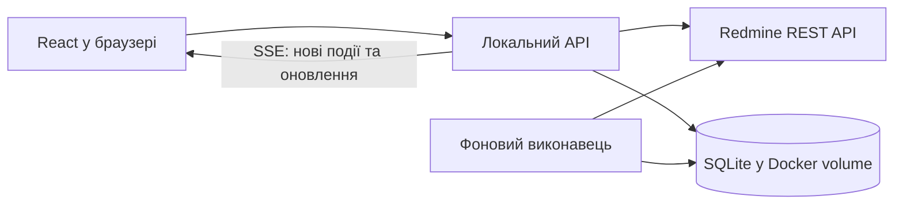

# Технічні рішення реалізації

Дата: 2026-10-02. Статус: SQLite, Drizzle ORM / Kit та `.env` погоджені; решта стеку — робочі пропозиції. Вибір простої структури користувач доручив агенту. Продуктові вимоги: [RESEARCH.md](RESEARCH.md), перевірки: [REVIEW.md](REVIEW.md). Код застосунку не створено; приватний API не тестували. Токен буде додано пізніше.

## 1. Базова архітектура

Пропозиція: React + TypeScript у браузері; Node.js + TypeScript + Fastify як локальний сервер; фоновий виконавець у тому самому серверному процесі; SQLite у постійному Docker volume. Один контейнер застосунку, один екземпляр сервера, запуск через Docker Compose. Зібраний frontend сервер віддає з того самого origin, що й API. Порт публікується на 127.0.0.1.



API та виконавець — модулі одного застосунку. Це дозволяє працювати із закритою вкладкою, не потребує окремого сервісу черги. SQLite транзакції короткі; мережеві запити до Redmine виконуються поза транзакціями. Довгі CPU-операції не блокують серверний цикл.

## 2. Пропонований стек

| Частина | Пропозиція | Навіщо |
| --- | --- | --- |
| Інтерфейс | React + TypeScript, Vite | Дошка, модальні картки, швидке редагування; спільні типи із сервером |
| Дані в браузері | TanStack Query | Кеш запитів, фонове оновлення, контроль стану збереження |
| Drag and drop | dnd kit | Переміщення карток мишею та клавіатурою; бібліотека не визначає правила Redmine |
| Сервер | Node.js актуальної підтримуваної LTS + Fastify | Доступ до Redmine, команди, синхронізація, локальне API |
| Локальна БД | SQLite + Drizzle, міграції | Налаштування, inbox, ролі, стійкі операції та кеш |
| Мови | i18next + react-i18next | uk / pl / es / en, повідомлення й форми множини |

Версії зафіксувати при створенні проєкту, перевіривши сумісність; без автоматичного вибору prerelease / RC. Поточна Drizzle-документація містить RC-приклади — це не рекомендація встановлювати RC. Драйвер SQLite обрати після перевірки стабільних версій Node.js / ORM і Docker-збірки.

Конкретну бібліотеку UI-компонентів вибрати після першого макета; компоненти мають підтримувати focus, клавіатуру, popover і dialog. Формат редактора залежить від фактичного форматування Redmine (Markdown / Textile). Не конвертувати наявні описи без втрат; на першому етапі зберігати оригінальну розмітку, забезпечити preview із санітизацією.

Офіційні джерела перевірено 2026-10-02: [Vite](https://vite.dev/guide/), [Fastify](https://fastify.dev/docs/latest/), [TanStack Query](https://github.com/TanStack/query), [dnd kit](https://dndkit.com/), [Drizzle SQLite](https://orm.drizzle.team/docs/sqlite/get-started-sqlite), [react-i18next](https://react.i18next.com/).

### 2.1. ORM / query builder і міграції

**Погоджено 2026-10-02 відповіддю «ок, lgtm»: Drizzle ORM + Drizzle Kit**, зі схемою в TypeScript і збереженими SQL-міграціями. Наступною відповіддю погоджено SQLite; драйвер вибрати під час реалізації за сумісністю.

Drizzle дозволяє описувати схему в TypeScript, використовувати типізовані SQL-подібні запити й relational API; підтримує SQLite та PostgreSQL ([огляд](https://orm.drizzle.team/docs/overview)). Для нашого застосунку це поєднує визначення таблиць, запити до inbox / операцій / налаштувань і контроль змін схеми. ORM працює лише з локальною БД; інтеграція з Redmine залишається HTTP-адаптером.

Пропонований процес: TypeScript schema → `drizzle-kit generate` → перегляд SQL-міграції → commit міграції → застосування невиконаних міграцій перед запуском сервера / виконавця, після backup наявної БД. Не використовувати `push` як штатний механізм оновлення користувацької БД. Drizzle Kit документує обидва підходи; збережені SQL-файли обираємо для контрольованих оновлень і перевірки restore ([міграції](https://orm.drizzle.team/docs/migrations)).

Залежності й драйвер фіксувати після перевірки сумісності. Вибрати один діалект для першої версії: підтримка двох БД у бібліотеці не означає, що таблиці / типи / SQL-міграції проєкту автоматично переносимі між ними. Окремий універсальний DAL для одночасної підтримки SQLite / PostgreSQL не пропонується.

## 3. SQLite чи PostgreSQL

**Погоджено 2026-10-02: SQLite у постійному Docker volume.** Користувач зазначив, що обидві БД зберігатимуть дані в volume. Це правильно щодо стійкого збереження; підстава вибору SQLite — простіший запуск без окремого сервера БД. Паралельні записи й backup / restore також залежать від обраної БД.

SQLite — локальна БД у контейнері, без окремого database server. Файл і службові файли живуть у Docker named volume, зберігаються при оновленні контейнера. Режим WAL, foreign keys, busy timeout; один координатор записів. SQLite добре відповідає локальному збереженню стану застосунку ([рекомендовані сценарії](https://www.sqlite.org/whentouse.html)).

WAL дозволяє паралельне читання й запис, але не кілька одночасних writer-транзакцій; БД не розміщувати на мережевій файловій системі ([WAL](https://www.sqlite.org/wal.html)). Backup — через штатний механізм узгодженого snapshot або зупинку застосунку, не копіювання лише основного файла під час запису. Перед міграцією backup; окремо перевірити restore.

PostgreSQL у другому контейнері доречний, якщо користувач хоче окремий сервер БД або надалі кількох користувачів / виконавців. Перехід між діалектами потребуватиме міграцій і перевірок, він не обіцяється як автоматичний. Redis і зовнішня черга для поточного масштабу не потрібні.

## 4. Межа між Redmine та локальними даними

Redmine — джерело актуальних задач, статусів, виконавців, описів, коментарів, labels, Branch і Versions. Локальна БД — налаштування проєктів / QA, подання, shortcuts, мова, підтверджені локальні ролі, чернетки, події / unread / архів, позиції синхронізації та виконання операцій. Дозволений кеш Redmine з часом останнього оновлення.

Приблизні сутності: project_settings, saved_views, shortcuts, issue_roles, drafts, cached_issues, cached_versions, source_events, notifications, sync_cursors, automation_rules, operations, operation_steps. Усі зовнішні ID мають контекст інстансу Redmine; очищення кешу не видаляє inbox або налаштування.

## 5. Єдиний шлях виконання дій

Drag and drop, shortcut, меню й автоматизація викликають спільні серверні команди: moveIssue, updateIssue, handoffToQA, returnToDeveloper, createIssueWithBranch, finishRelease. UI не дублює правила workflow.

Перед записом — актуальна задача, перевірка передумов і доступного переходу. Зміни від інших користувачів після цієї перевірки все одно можливі: стандартний REST не дає атомарного compare-and-set для всього сценарію. Після кроку перечитати результат, при конфлікті зупинитися й показати фактичний стан.

Операція та її кроки спочатку зберігаються в БД. Повтори локального запиту використовують operation ID; записи по одній задачі серіалізовані. Review → QA виконується як assign self → QA → обраний QA; finishRelease — перевірка готовності → закриття задач → перевірка складу → закриття Version. Прогрес переживає restart. Частково виконана команда показує реальні зміни, не вдає повний успіх.

Після timeout не повторювати POST створення задачі / коментаря наосліп. Спочатку перевіряти результат; якщо його неможливо однозначно встановити, позначати як невідомий і вимагати розв'язання. Локальний operation ID сам по собі не робить Redmine API ідемпотентним.

UI може одразу показувати просте редагування як pending. Для багатокрокової передачі / завершення — видимий прогрес і фінальний фактичний стан. Чернетки не губляться при помилці. Drag and drop змінює статус / роадмапу за погодженими правилами, не створює ручний порядок карток: усередині колонки діє вибране сортування, default Priority desc.

## 6. Синхронізація й доставка в UI

Фоновий polling Redmine незалежно від браузера. Початкова пропозиція інтервалу — близько 30 секунд, із налаштуванням; це не обіцянка оновлення за 30 секунд для всіх проєктів. Частоту й кількість паралельних запитів визначити за обсягом даних і лімітами інсталяції, застосувати backoff. Навіть без підписки перевіряти погоджені активні автоматизації та задачі користувача.

Перший запуск створює baseline, не засипає inbox старою історією. Подальші цикли читають усі сторінки змінених задач і потрібні journals із часовим перекриттям; cursor пересувається лише після стійкого збереження результатів. Journal IDs забезпечують дедуплікацію. Повторна звірка потрібна для членства / watchers / Versions / змін прав. Видалені чи недоступні задачі не залишаються у кеші як чинні.

Важлива межа: polling snapshot не гарантує, що побачимо кожен проміжний перехід labels. Для CI In Progress → Failed потрібна доступна історія old / new; якщо поле не журналюється, потрібна інша інтеграція або чесно обмежене правило. Не видавати зміну snapshot за повну історію подій.

Сервер надсилає браузеру сигнали оновлення через SSE; звичайні команди йдуть HTTP. SSE — доставка від нашого сервера, не канал подій від Redmine ([опис SSE](https://developer.mozilla.org/en-US/docs/Web/API/Server-sent_events/Using_server-sent_events)). Inbox спочатку зберігається в БД; після reconnect UI перечитує його та лічильники. Кілька вкладок не запускають кілька polling-циклів. Favicon відображає стійкий unread count.

## 7. Токен і підключення

Погоджено 2026-10-02: користувач додасть токен у `.env` у корені проєкту. Пропонований контракт конфігурації:

```dotenv
REDMINE_URL=https://redmine.example.invalid
REDMINE_API_TOKEN=
```

При реалізації додати `.env` до `.gitignore` і `.dockerignore`; у репозиторії зберігати лише `.env.example` з порожнім токеном. Docker Compose явно передає ці змінні серверному контейнеру: сам факт існування `.env` не означає їх автоматичної наявності всередині контейнера. При зміні токена перестворити контейнер застосунку з новою конфігурацією, не видаляючи volume.

Ключ читає лише backend; браузер бачить стан підключення, а не ключ. Не використовувати префікс `VITE_` для токена, не передавати його в frontend build arguments і не включати `.env` у Docker image. Токен не зберігається в локальній БД або browser storage. Екран введення токена та шифроване сховище в поточний план не включати.

Логи не містять ключа; секретні поля відповіді current user відкидаються. API запису перевіряє origin / локальну сесію. Контейнер має використовувати справжній TLS, без вимикання перевірки сертифікатів; доступ через корпоративну VPN перевірити окремо.

Після додавання токена виконати read-only capability-перевірку: поточний користувач, проєкти, IDs та is_closed статусів, writable поля Branch / Labels, формат описів, Versions, journals, watchers і workflow. Записи не робити просто для перевірки підключення. Без токена — ізольований деморежим із тим самим контрактом адаптера, чітким позначенням demo.

## 8. Перевірки реалізації й порядок

Спочатку створити базовий Docker-запуск, міграції й адаптер demo / Redmine; побудувати дошку, картку, inline editing, фільтри та i18n. Далі реалізувати стійкі команди, фонову синхронізацію, inbox, релізи, погоджені автоматизації та налаштування. Це порядок роботи, не скорочення погодженого обсягу.

Перевірки фокусуються на реальних ризиках: групування roadmap / status; відновлення після часткового запису й restart; timeout після успішного запису; конфлікт іншого користувача; pagination / дедуплікація / cursor; CI old / new; unread; branch після створення; backup / restore. Інтерфейсні сценарії — перетягування, inline editing, keyboard focus / shortcuts, чотири мови. Приватну інтеграцію можна підтвердити лише після перевірки інсталяції.

## 9. Стан рішень

Локальна БД, ORM і міграції погоджені: SQLite + Drizzle ORM + Drizzle Kit. Вибір простої структури користувач доручив агенту; конкретний план наведено в розділі 10.

Погоджено: локальний Docker, один користувач, фонова робота, продуктова поведінка з RESEARCH.md. 2026-10-02 користувач погодив автоматичне закриття задач при завершенні релізу без колонки Done чи ручного кроку та надання токена через `.env` у проєкті.

Пропонується, ще не погоджено: решта стеку, один контейнер / один процес, SSE та інтервали polling. Правило вже Done погоджене: пропускати, перевіряти Deploy для решти.

## 10. Проста структура проєкту

Користувач доручив вибір структури агенту й не планує вручну підтримувати проєкт. Прийняте реалізаційне рішення: один проєкт, один package.json, зрозумілі каталоги за відповідальністю. Нижче план розміщення майбутнього коду; порожні файли й каталоги заради дерева не створювати.

```text
src/
  client/
    app/               # запуск UI, навігація, провайдери
    features/          # board, issues, releases, notifications, settings
    components/        # спільні UI-компоненти
    lib/               # локальний API client, shortcuts
    locales/           # uk, pl, es, en
  server/
    index.ts           # запуск API та фонового виконавця
    config.ts          # серверна конфігурація, .env
    routes/            # HTTP endpoints і SSE
    redmine/           # REST client, mapping, capabilities, demo adapter
    commands/          # редагування, передачі, Branch, завершення релізу
    sync/              # polling, journals, cursors, автоматизації
    db/                # підключення, schema, запити
  shared/              # DTO, validation schemas, типи команд і подій
drizzle/               # SQL-міграції та їх метадані
Dockerfile
compose.yaml
.env.example
package.json
```

Тести розміщувати поруч із відповідним модулем; браузерні сценарії — в e2e/. Конфігурації збірки й перевірок — у корені. Наявні RESEARCH.md, REVIEW.md і TECHNICAL.md лишаються в корені.

Правила для реалізації: client не імпортує server; shared не містить токена, доступу до БД або серверної конфігурації. routes перевіряють запит і викликають команди; бізнес-правила не розмазуються між UI, shortcut і polling. server/db містить конкретні запити, нові шари й абстракції додавати лише під реальну потребу. Один модуль не повинен перетворюватися на весь backend або всю дошку.

## 11. Питання перед початком реалізації

Останнє продуктове уточнення погоджено 2026-10-02: реліз містить дві задачі в Deploy та одну, яку вже завершили в Done через Redmine. Пропозиція — дозволити завершення, уже успішно завершену задачу пропустити, а Deploy перевіряти для решти. Rejected або довільний статус із `is_closed` не прирівнювати автоматично до успішного завершення. Користувач погодив це правило 2026-10-02; питання закрито.

Реалізацію дозволено почати. Решта невизначеностей — вибір реалізаційних деталей або перевірки інсталяції після додавання токена: поля / статуси / права, формат описів, історія CI, джерела ролей і доступ контейнера до Redmine. Повторного продуктового опитування про них не потрібно.

## 12. Режим розробки та обмеження інтеграції

Користувач дозволив реалізацію, Git і development subagents gpt-6-luna з max reasoning. Усі зовнішні мутації заборонені під час розробки навіть із токеном. AGENTS.md — обов’язкове джерело цієї заборони. Сервер реалізує immutable read-only real adapter і transport, GET / HEAD only, без перемикача обходу. Demo adapter дозволяє всі UX-сценарії в ізольованій локальній БД. У real mode UI показує read-only та явно блокує write actions; автоматизації лише фіксують заплановані заблоковані дії.
